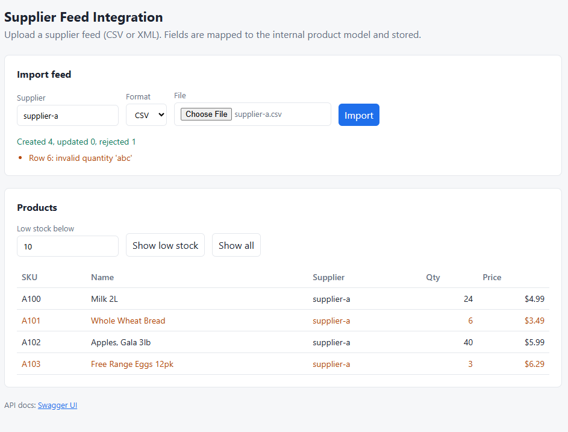
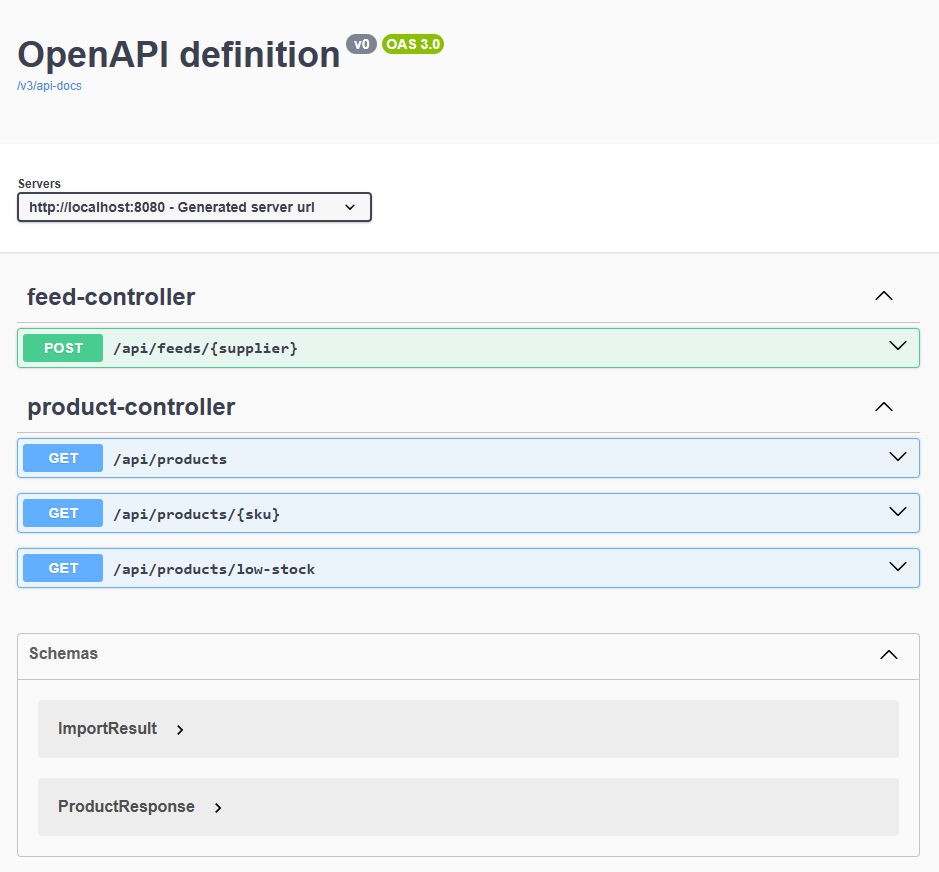

# Supplier Feed Integration

A Spring Boot app that imports product data from suppliers.

Each supplier sends data in a different format (CSV or XML) with different field names. This app maps them into one product format, saves them to PostgreSQL, and provides a REST API. Bad rows are skipped and reported, and the rest of the file is still imported.

**Tech:** Java 21, Spring Boot 3, PostgreSQL, JUnit 5, Mockito, Docker, GitHub Actions

## Screenshots




## JUnit Tests

| Test | What it checks |
|------|----------------|
| `CsvFeedMapperTest` | CSV fields map correctly, bad rows are reported, missing columns fail |
| `XmlFeedMapperTest` | XML fields map correctly, broken XML fails, XXE attacks are blocked |
| `FeedImportServiceTest` | New products are created, existing ones are updated (Mockito) |
| `FeedControllerTest` | Upload API returns correct results and errors (MockMvc) |
| `ProductControllerTest` | Product API returns data and 404 for unknown SKU (MockMvc) |

Run tests:

```bash
mvn test
```

## Run

```bash
docker compose up -d --build
```

Open http://localhost:8080